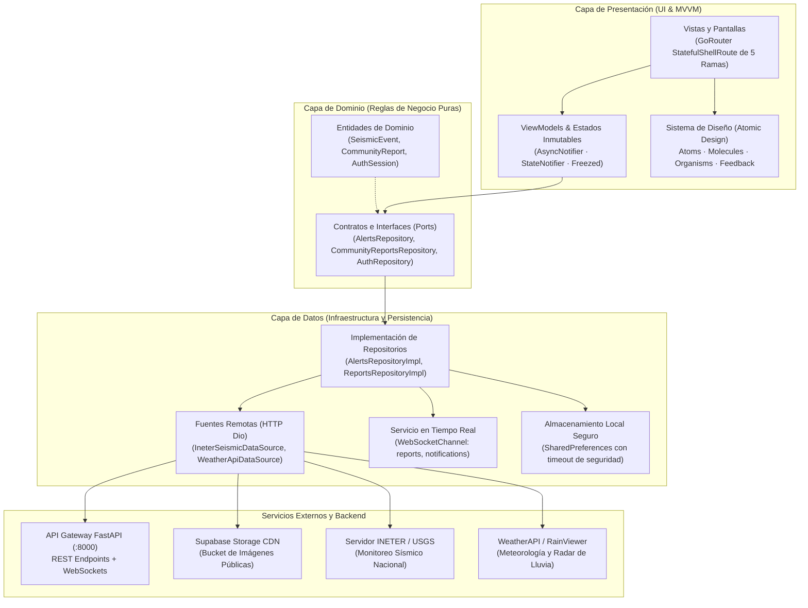
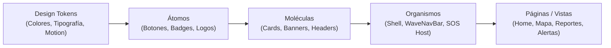
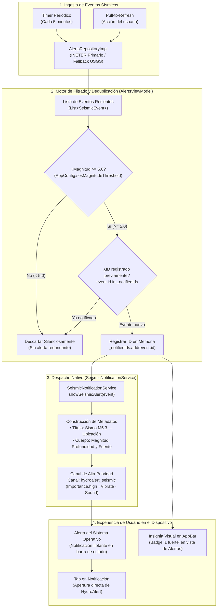

# HydroAlert · App Móvil

<p align="center">
  
</p>

<p align="center">
  <strong>Información que protege en tiempo real.</strong><br>
  Plataforma móvil para Nicaragua que integra monitoreo sísmico oficial (INETER), condiciones meteorológicas, radar de precipitaciones y red ciudadana de reportes de emergencia en una interfaz intuitiva, accesible y de baja carga cognitiva.
</p>

<p align="center">
  
  
  
  
  
  
</p>

---

## 1. Módulos y Funcionalidades

| Pestaña | Propósito Operativo | Capacidades Clave |
| :--- | :--- | :--- |
| **Inicio** | Tablero de resumen y conciencia situacional | Saludo dinámico, clima actual de la zona, últimos 3 sismos con acceso directo a detalles, últimos reportes y acceso rápido a la guía de emergencia. |
| **Mapa** | Visualización geoespacial interactiva | Google Maps con pines SVG/Bitmap a resolución nativa, visualización de sismos con escala por magnitud, dispersión radial automática de pines coincidentes, capa de radar satelital RainViewer y geolocalización. |
| **Reportes** | Red colaborativa comunitaria | Feed de incidentes con fotografías (Supabase Storage), filtros por categoría y asistente multipart de dos pasos con geolocalización. Exploración 100% pública; publicación autenticada. |
| **Alertas** | Monitoreo técnico multivariable | Sismos INETER (respaldo USGS) con ruta directa de monitoreo en tiempo real, alertas de clima WeatherAPI (respaldo OpenWeather), cálculo de tiempos en huso horario local de Nicaragua (UTC-6) y **notificaciones locales automáticas** para sismos M≥5.0. |
| **Emergencia** | Protocolos y auxilio visual | Guía de actuación ante sismos/inundaciones/incendios y modo SOS visual a pantalla completa (destello intermitente sin consumo de batería en reposo). |

> [!NOTE]
> **Acceso como Invitado:** El mapa, el tablero de inicio, las alertas técnicas y la consulta de reportes están siempre abiertos a cualquier usuario sin necesidad de registro ni inicio de sesión. Solo al presionar **Publicar** en un nuevo reporte se solicita iniciar sesión o crear una cuenta de reportante mediante un modal no bloqueante.

---

## 2. Mapa de Arquitectura del Sistema

La aplicación está diseñada bajo principios de **Screaming Architecture**, desacoplamiento de capas (**Clean Architecture**), patrón **MVVM** mediante **Riverpod 3**, e interfaz modular inspirada en **Atomic Design**.

### 2.1 Diagrama de Componentes y Flujo de Datos



---

## 3. Sistema de Diseño & Atomic Design

La interfaz de usuario de HydroAlert está estructurada bajo la metodología de **Atomic Design** (Brad Frost), garantizando consistencia visual, desacoplamiento estricto de la lógica y alta reusabilidad tanto en estados normales como en situaciones de emergencia.



### 3.1 Estructura por Capas Atómicas en `lib/shared/`

* **Design Tokens (`lib/app/theme/`)**:
  - `AppColors`: Paleta cromática centralizada con contraste validado para emergencias (`brandOrange`, `seismicStrong`, `categoryOther` violeta, etc.).
  - `AppPalette`: Sistema de temas reactivo claro y oscuro inyectado como `ThemeExtension` para adaptación automática al sistema operativo (`ThemeMode.system`).
  - `AppTypography`: Jerarquía de fuentes con interlineado optimizado para lectura rápida y legible bajo luz solar directa.
  - `AppMotion`: Constantes de velocidad y curvas de animación para interacción fluida sin fatiga visual.

* **Átomos (`lib/shared/atoms/`)**: Unidades indivisibles y reutilizables.
  - `CustomButton`: Botón háptico con variantes (`primary`, `secondary`, `outline`, `danger`), estados de carga (`isBusy`) e icono adaptable.
  - `AlertBadge`: Insignia visual con código de color dinámico para magnitudes de sismo, estados y categorías.
  - `AppLogo`: Isotipo y logotipo vectorial adaptable al fondo.
  - `StatusIndicator`: Indicador pulsante del estado de la conexión en tiempo real.

* **Moléculas (`lib/shared/molecules/`)**: Combinaciones de átomos con propósito funcional.
  - `AppCard`: Contenedor base elevado con esquinas redondeadas, soporte táctil (`onTap`) y tratamiento de elevación.
  - `InfoBanner`: Bloque informativo para avisos y estados de advertencia (`warning`, `info`, `danger`, `success`).
  - `SectionHeader`: Título de bloque con subtítulo explicativo y acción secundaria.

* **Organismos (`lib/shared/organisms/`)**: Componentes complejos que gestionan regiones completas de la interfaz.
  - `AppShell`: Estructura principal que sostiene la navegación entre las cinco pestañas mediante la barra personalizada `WaveNavBar` (barra ondulada de navegación con elevación sobre el mapa).
  - `CriticalAlertHost`: Orquestador de alertas críticas que proyecta ventanas flotantes inmediatas sobre cualquier pantalla al registrar sismos de magnitud $\ge 5.0$ o avisos de emergencia vía WebSockets/Push.

* **Feedback y Movimiento (`lib/shared/feedback/` y `lib/shared/motion/`)**:
  - `LoadingState`, `ErrorState`, `EmptyState`: Estados normalizados para peticiones asíncronas con opción de reintento.
  - `AppAnimatedEntrance`: Entrada escalonada de elementos con retraso incremental para guiar la atención del usuario.
  - `AppPressScale`: Microinteracción física que reduce la escala del elemento al toque para retroalimentación táctil inmediata.

---

## 4. Guía de Navegación: ¿Dónde encontrar cada cosa?

Para facilitar el mantenimiento y la extensibilidad, la solución organiza sus archivos por contexto de dominio y responsabilidad:

| Responsabilidad | Ubicación en el Proyecto | Archivos y Componentes Clave |
| :--- | :--- | :--- |
| **Configuración & Entorno** | [`lib/app/config/`](file:///c:/Users/Walter_Jiron/proyects/ProfeTania/hydro_alert/lib/app/config/) | [`app_config.dart`](file:///c:/Users/Walter_Jiron/proyects/ProfeTania/hydro_alert/lib/app/config/app_config.dart): Lectura de `--dart-define`, detección de plataforma (Android emulator `10.0.2.2` vs localhost) y resolución de URLs de CDN. |
| **Constantes & Endpoints** | [`lib/app/constants/`](file:///c:/Users/Walter_Jiron/proyects/ProfeTania/hydro_alert/lib/app/constants/) | [`api_endpoints.dart`](file:///c:/Users/Walter_Jiron/proyects/ProfeTania/hydro_alert/lib/app/constants/api_endpoints.dart): URLs oficiales de INETER en tiempo real, USGS, rutas REST y coordenadas geográficas de Nicaragua. |
| **Enrutamiento** | [`lib/app/router/`](file:///c:/Users/Walter_Jiron/proyects/ProfeTania/hydro_alert/lib/app/router/) | [`app_router.dart`](file:///c:/Users/Walter_Jiron/proyects/ProfeTania/hydro_alert/lib/app/router/app_router.dart): Configuración de `GoRouter`, rutas hijas, transiciones y estructura `StatefulShellRoute`. |
| **Tokens & Temas** | [`lib/app/theme/`](file:///c:/Users/Walter_Jiron/proyects/ProfeTania/hydro_alert/lib/app/theme/) | [`app_colors.dart`](file:///c:/Users/Walter_Jiron/proyects/ProfeTania/hydro_alert/lib/app/theme/app_colors.dart), [`app_typography.dart`](file:///c:/Users/Walter_Jiron/proyects/ProfeTania/hydro_alert/lib/app/theme/app_typography.dart), [`app_theme.dart`](file:///c:/Users/Walter_Jiron/proyects/ProfeTania/hydro_alert/lib/app/theme/app_theme.dart): Paleta centralizada, soporte dinámico claro/oscuro (`AppPalette`) y Material 3. |
| **Red & Fallos** | [`lib/core/network/`](file:///c:/Users/Walter_Jiron/proyects/ProfeTania/hydro_alert/lib/core/network/) | [`api_client.dart`](file:///c:/Users/Walter_Jiron/proyects/ProfeTania/hydro_alert/lib/core/network/api_client.dart), [`error_handler.dart`](file:///c:/Users/Walter_Jiron/proyects/ProfeTania/hydro_alert/lib/core/network/error_handler.dart): Interceptores Dio y traducción de errores del backend (inglés a mensajes amigables en español). |
| **Servicios del Sistema** | [`lib/core/services/`](file:///c:/Users/Walter_Jiron/proyects/ProfeTania/hydro_alert/lib/core/services/) | [`realtime_service.dart`](file:///c:/Users/Walter_Jiron/proyects/ProfeTania/hydro_alert/lib/core/services/realtime_service.dart) (WebSocket con reconexión exponencial y ping a 30s), [`location_service.dart`](file:///c:/Users/Walter_Jiron/proyects/ProfeTania/hydro_alert/lib/core/services/location_service.dart), [`notification_service.dart`](file:///c:/Users/Walter_Jiron/proyects/ProfeTania/hydro_alert/lib/core/services/notification_service.dart). |
| **Módulo de Sismos & Clima** | [`lib/features/alerts/`](file:///c:/Users/Walter_Jiron/proyects/ProfeTania/hydro_alert/lib/features/alerts/) | [`ineter_seismic_datasource.dart`](file:///c:/Users/Walter_Jiron/proyects/ProfeTania/hydro_alert/lib/features/alerts/data/datasources/ineter_seismic_datasource.dart), [`alerts_viewmodel.dart`](file:///c:/Users/Walter_Jiron/proyects/ProfeTania/hydro_alert/lib/features/alerts/presentation/viewmodels/alerts_viewmodel.dart), hojas de detalle de sismos e incidentes. |
| **Módulo de Autenticación** | [`lib/features/auth/`](file:///c:/Users/Walter_Jiron/proyects/ProfeTania/hydro_alert/lib/features/auth/) | [`auth_viewmodel.dart`](file:///c:/Users/Walter_Jiron/proyects/ProfeTania/hydro_alert/lib/features/auth/presentation/viewmodels/auth_viewmodel.dart), [`auth_sheet.dart`](file:///c:/Users/Walter_Jiron/proyects/ProfeTania/hydro_alert/lib/features/auth/presentation/widgets/auth_sheet.dart): Modal de login/registro, validación de cédula nicaragüense y almacenamiento de token `Bearer`. |
| **Módulo de Reportes** | [`lib/features/community_reports/`](file:///c:/Users/Walter_Jiron/proyects/ProfeTania/hydro_alert/lib/features/community_reports/) | [`report_wizard_view.dart`](file:///c:/Users/Walter_Jiron/proyects/ProfeTania/hydro_alert/lib/features/community_reports/presentation/views/report_wizard_view.dart): Flujo guiado de dos pasos con compresión de foto, categorías (`ReportCategory`) y envío multipart. |
| **Módulo de Mapa Operativo** | [`lib/features/map/`](file:///c:/Users/Walter_Jiron/proyects/ProfeTania/hydro_alert/lib/features/map/) | [`live_map_view.dart`](file:///c:/Users/Walter_Jiron/proyects/ProfeTania/hydro_alert/lib/features/map/presentation/views/live_map_view.dart), [`map_marker_controller.dart`](file:///c:/Users/Walter_Jiron/proyects/ProfeTania/hydro_alert/lib/features/map/presentation/controllers/map_marker_controller.dart): Generación de pines Bitmap con resolución por pantalla y algoritmo de dispersión de coordenadas coincidentes. |
| **Tablero de Inicio (Home)** | [`lib/features/home/`](file:///c:/Users/Walter_Jiron/proyects/ProfeTania/hydro_alert/lib/features/home/) | [`home_view.dart`](file:///c:/Users/Walter_Jiron/proyects/ProfeTania/hydro_alert/lib/features/home/presentation/views/home_view.dart), [`home_seismic_section.dart`](file:///c:/Users/Walter_Jiron/proyects/ProfeTania/hydro_alert/lib/features/home/presentation/widgets/home_seismic_section.dart): Tarjetas con evento `onTap` que activan modales completos de detalle. |
| **Átomos & Moléculas (UI)** | [`lib/shared/`](file:///c:/Users/Walter_Jiron/proyects/ProfeTania/hydro_alert/lib/shared/) | [`custom_button.dart`](file:///c:/Users/Walter_Jiron/proyects/ProfeTania/hydro_alert/lib/shared/atoms/custom_button.dart), [`app_card.dart`](file:///c:/Users/Walter_Jiron/proyects/ProfeTania/hydro_alert/lib/shared/molecules/app_card.dart), [`state_views.dart`](file:///c:/Users/Walter_Jiron/proyects/ProfeTania/hydro_alert/lib/shared/feedback/state_views.dart), [`wave_nav_bar.dart`](file:///c:/Users/Walter_Jiron/proyects/ProfeTania/hydro_alert/lib/shared/organisms/wave_nav_bar.dart): Componentes reutilizables con animación y respuesta táctil. |

---

## 5. Guía de Instalación y Puesta en Marcha

Sigue estos pasos para clonar, configurar el entorno y ejecutar HydroAlert en dispositivos físicos o emuladores.

### 5.1 Requisitos Previos

- **Flutter SDK:** Versión `>= 3.24.0` (recomendado canal `stable`).
- **Dart SDK:** Versión `>= 3.5.0`.
- **JDK:** OpenJDK 17 configurado en el sistema (`JAVA_HOME`).
- **Android Studio / Android SDK:** Android SDK Command-line Tools y Build-Tools `>= 34.0.0`.
- **Xcode (solo macOS/iOS):** Versión 15+ con CocoaPods instalado (`sudo gem install cocoapods`).
- **Git** instalado.

---

### 5.2 Paso 1: Clonar el Repositorio e Instalar Dependencias

Abre una terminal y ejecuta:

```bash
cd proyects/ProfeTania/hydro_alert
flutter pub get
```

---

### 5.3 Paso 2: Generación de Código Automatizado

El proyecto utiliza generadores de código para inmutabilidad (`freezed`), serialización JSON (`json_serializable`) y proveedores de estado (`riverpod_generator`).

Ejecuta el generador para asegurar que todos los archivos `*.g.dart` y `*.freezed.dart` estén actualizados:

```bash
dart run build_runner build --delete-conflicting-outputs
```

---

### 5.4 Paso 3: Configuración de Google Maps API Key

Para renderizar la cartografía en la pestaña **Mapa**, se requiere una clave de Google Maps con **Maps SDK for Android** y **Maps SDK for iOS** habilitados en Google Cloud Console.

#### En Android
Crea o edita el archivo `android/local.properties` (este archivo está excluido de git por seguridad):

```properties
sdk.dir=C:\\Users\\TuUsuario\\AppData\\Local\\Android\\Sdk
flutter.sdk=C:\\Users\\TuUsuario\\flutter
GOOGLE_MAPS_API_KEY=AIzaSyTuClaveDeGoogleMapsAqui
```

> [!TIP]
> `android/app/build.gradle.kts` inyecta automáticamente esta variable en el `AndroidManifest.xml` como `com.google.android.geo.API_KEY`.

#### En iOS
Asegúrate de configurar la clave en `ios/Runner/AppDelegate.swift`:
```swift
GMSServices.provideAPIKey("AIzaSyTuClaveDeGoogleMapsAqui")
```

---

### 5.5 Paso 4: Conexión con el Backend Local (FastAPI)

El backend de HydroAlert se ejecuta en Docker en el puerto `8000`. Dependiendo del entorno en el que ejecutes la app móvil:

#### A) En Emulador Android Oficial:
El emulador de Google mapea el `localhost` de tu computadora en la dirección IP `10.0.2.2`.
- `API_BASE_URL=http://10.0.2.2:8000/api/v1` *(predeterminado automático)*.

#### B) En Dispositivo Físico Android por USB:
Para que tu teléfono conectado por cable acceda al servidor Docker local en `localhost:8000`:
1. Asegúrate de tener activa la depuración USB en tu dispositivo.
2. Ejecuta el reenvío de puertos mediante ADB:
   ```bash
   adb reverse tcp:8000 tcp:8000
   ```
3. Ahora el teléfono puede consultar `http://localhost:8000/api/v1` de forma transparente.

---

### 5.6 Paso 5: Ejecución de la Aplicación

Puedes ejecutar la app pasando las variables de entorno mediante `--dart-define`:

#### Ejecución Estándar con Backend Local:
```bash
flutter run \
  --dart-define=API_BASE_URL=http://localhost:8000/api/v1 \
  --dart-define=WEATHERAPI_KEY=tu_clave_opcional
```

---

### 5.7 Tabla Completa de Variables de Compilación (`--dart-define`)

| Variable | Tipo | Valor Predeterminado | Propósito |
| :--- | :--- | :--- | :--- |
| `API_BASE_URL` | String | `http://10.0.2.2:8000/api/v1` (Android)<br>`http://localhost:8000/api/v1` (Otros) | URL base contractual de la API FastAPI. Si se omite `/api/v1`, la app lo concatena de forma segura. |
| `WEATHERAPI_KEY` | String | *Vacío* | Clave de acceso a WeatherAPI para pronóstico meteorológico y alertas en Managua. |
| `OPENWEATHER_API_KEY`| String | *Vacío* | Clave de OpenWeatherMap One Call 3.0 (utilizada exclusivamente como fallback ante caídas). |
| `FIREBASE_ENABLED` | bool | `false` | Activa el registro en segundo plano de Firebase Cloud Messaging (FCM). |
| `SOS_MAGNITUDE_THRESHOLD` | double | `5.0` | Umbral mínimo de magnitud sísmica para disparar la tarjeta de emergencia prioritaria. |
| `SOS_EVENT_MAX_AGE_MINUTES` | int | `15` | Tiempo máximo en minutos de un sismo para considerarlo activo para alerta prioritaria. |

---

## 6. Control de Calidad y Pruebas

El proyecto cuenta con un riguroso estándar de calidad de código y cobertura de pruebas automatizadas:

```bash
# 1. Formateo estricto de código Dart
dart format lib test

# 2. Análisis estático (Reglas Linter de Flutter & Pedantic)
flutter analyze

# 3. Ejecución de suite de pruebas unitarias y de widgets
flutter test
```

> [!NOTE]
> Estado actual: **0 incidencias** en `flutter analyze` y **63 pruebas automatizadas aprobadas al 100%** (incluyendo validación de dispersión de pines en mapa, esquemas de error del backend, mapeo INETER/USGS y notificaciones sísmicas locales).

---

## 8. Permisos de Plataforma

La aplicación implementa el principio de privilegio mínimo; los permisos nunca se piden al inicio, sino de forma diferida en el momento exacto en que el usuario interactúa con la función:

- **Ubicación (`ACCESS_FINE_LOCATION`, `ACCESS_COARSE_LOCATION`):** Solicitada solo cuando se pulsa el botón de centrar en el mapa o en el paso 2 del asistente de reportes comunitarios.
- **Cámara (`CAMERA`):** Solicitada únicamente si el usuario elige tomar una fotografía en vivo para evidenciar su reporte.
- **Almacenamiento / Galería (`READ_MEDIA_IMAGES`):** Solicitada al adjuntar una foto existente desde la fototeca del teléfono.
- **Notificaciones (`POST_NOTIFICATIONS`, `VIBRATE`):** Solicitada en el primer sismo M≥5.0 detectado en la sesión. Nunca se pide al arranque.

---

## 9. Notificaciones Sísmicas Locales

HydroAlert emite una **notificación del sistema** (canal `hydroalert_seismic`, prioridad alta) cada vez que el monitor INETER detecta un sismo nuevo de **magnitud ≥ 5.0** durante la sesión.

### Comportamiento

| Aspecto | Detalle |
| :--- | :--- |
| **Motor** | `flutter_local_notifications` (con Java core desugaring) — 100% independiente de Firebase |
| **Canal Android** | `hydroalert_seismic` · Importancia **Alta** (Heads-up) · Vibración + Sonido |
| **Umbral Sísmico** | Parametrizable via `--dart-define=SOS_MAGNITUDE_THRESHOLD=5.0` (por defecto M5.0) |
| **Deduplicación** | Hash determinista por `event.id`; actualiza el banner sin generar spam |
| **Protección Inicial**| Sismos históricos al abrir la app se memorizan sin disparar falsas alarmas |
| **Gestión de Permisos**| Solicitud diferida e incremental (Android 13+ / iOS) ante el primer evento real |

### 9.1 Flujo Operativo del Pipeline de Alertas



### 9.2 Fases del Ciclo de Notificación

1. **Ingesta Multi-Fuente:** `AlertsViewModel` consulta el feed de eventos sísmicos cada 5 minutos de forma silenciosa en segundo plano (y ante cada gesto de actualización manual), priorizando el catálogo oficial de INETER con conmutación por error a USGS ante fallas de red.
2. **Evaluación de Severidad:** Se filtran exclusivamente los sismos cuya magnitud supere o iguale el umbral crítico configurado (`SOS_MAGNITUDE_THRESHOLD`, 5.0 por defecto).
3. **Control de Idempotencia y Deduplicación:** Se mantiene un registro en memoria (`_notifiedIds`) de los sismos ya advertidos en la sesión. Durante el arranque inicial de la aplicación, el catálogo histórico se indexa de inmediato para evitar notificaciones retroactivas indeseadas.
4. **Despacho al Canal de Alta Prioridad:** Los sismos que superan el filtrado se envían a `SeismicNotificationService.showSeismicAlert()`, utilizando el canal Android `hydroalert_seismic` con vibración háptica y sonido para garantizar que la alerta sea percibida incluso con la app cerrada o en segundo plano.
5. **Sincronización con la UI:** Simultáneamente, el encabezado de la pestaña **Alertas** activa una insignia de advertencia (`_StrongEventsBadge`) indicando la cantidad de sismos de alta intensidad detectados en el ciclo actual.

### Integración con la Alerta Crítica (In-App)

El overlay de emergencia en pantalla completa (`CriticalAlertHost`) y la notificación del sistema funcionan en **capas independientes**:

- El overlay se dispara cuando `EmergencyViewModel.evaluateSeismicEvents()` identifica un evento reciente por encima del umbral.
- La notificación del sistema se dispara desde `AlertsViewModel` en cada ciclo de refresco.
- Ambas comparten el mismo `SOS_MAGNITUDE_THRESHOLD` de `AppConfig`.
